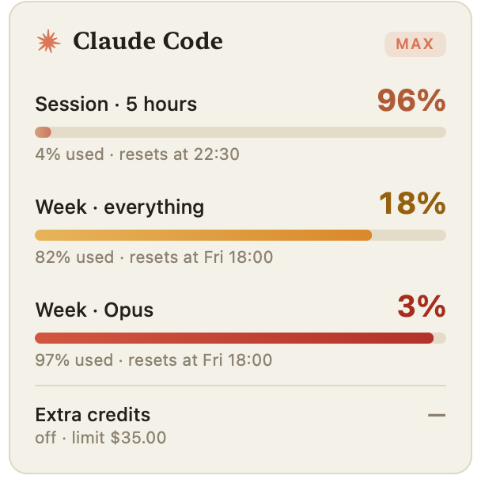

# Claude Usage

A small macOS menu bar app that shows how much of your Claude Code limits is
left: the 5-hour session window, the weekly windows and the extra-credit spend.



## Why this exists

> As a developer, I got tired of keeping an eye on my credits in a browser tab.
> I couldn't find an alternative anywhere, so I built my own app — one that not
> only shows how many credits I have left unused, but also lets me turn on
> **amphetamine mode**, where my MacBook never falls asleep, not even with the
> lid closed.

So the app does two jobs, and both live in the same menu:

| | |
| --- | --- |
| **Credits at a glance** | The percentage left sits right next to the clock, colour-coded, and the dropdown breaks it down by window — 5-hour session, weekly, per-model — with the exact time each one resets. |
| **Amphetamine mode** | One switch, with a timer, that keeps the Mac awake — including with the lid shut, which a normal power assertion cannot do on its own. |

The menu bar shows the Claude mark and the percentage left in the tightest
window, e.g. `✳ 96%`. Mark and number turn amber at ≤20% and brick red at ≤5%.
The dropdown lists every window with a meter and the remaining percentage, the
reset time, the state of extra credits, and a breakdown of the weekly window by
source (Claude Code / Chats / Cowork / other).

## Keeping the Mac awake

The menu carries a **“Не засинати”** / **“Don't sleep”** switch with a choice of
duration: 15 min, 30 min, 1 h, 2 h, 4 h, or until you switch it off. While it is
on, a dot appears next to the menu bar mark and the menu item itself shows the
time left.

Two different mechanisms are at work:

* **ordinary idle sleep** is held off by a power assertion
  (`PreventUserIdleSystemSleep`) — no password involved; you can see it in
  `pmset -g assertions` as `Claude Usage: keep awake`;
* **sleep with the lid closed** cannot be stopped by an assertion at all. The
  only thing that works is the system setting `pmset -a disablesleep 1`, which
  requires an administrator. That is why the **“Також із закритою кришкою”** /
  **“Also with the lid closed”** sub-item brings up the standard macOS password
  dialog when you turn it on. Cancel it and the guard still works, just only
  while the lid is open.

Ticking that box is enough on its own: if the keep-awake switch is off, turning
the box on turns the switch on too, open-ended — the setting means nothing
without it, and the point of the tick is to watch the Mac stay awake, not to arm
a preference for later. One click, one password prompt, and the submenu says
what actually happened.

It says it because the app checks rather than assumes. A password dialog that
closed is no proof the setting took, so after every change `pmset -g` is read
back, and the submenu only claims **“діє і з закритою кришкою”** / **“works with
the lid closed too”** when the system agrees. Cancel the prompt and it says so,
with **“Спробувати ще раз”** / **“Try again”** next to it instead of leaving
you to toggle the box off and on again.

Both halves of that used to need a second go, for two separate reasons, and
both are fixed:

* **the menu was rebuilt under the cursor.** Opening the menu starts a fetch,
  and when the fetch came back — half a second later, while you were reading
  down the submenu — every item was thrown away and recreated. The click then
  landed on an item that no longer existed and did nothing. The menu is now
  built once and only ever updated in place; anything that would change its
  shape waits until it closes, so nothing moves while you aim at it.
* **the password dialog went up too early.** It was raised from inside the
  menu's own click handler, with the menu still being tracked, so it could
  appear behind another window. The request now waits for the menu to be gone,
  and the app asks for the foreground first.

`disablesleep` outlives the process, so the app clears it on quit (with the same
password prompt) and, if a previous run ended abnormally, picks the state back
up on the next launch so you can switch it off. If clearing it is ever refused —
you cancel the prompt when switching the guard off — the Mac really still cannot
sleep, and the menu keeps a line at the top saying so until you deal with it,
rather than quietly claiming all is normal. To check by hand:
`pmset -g | grep SleepDisabled`.

## Language

The interface speaks Ukrainian and English. It picks one at launch from the
macOS language list — Ukrainian if that is what the system is set to, English
otherwise — and the **“Мова” / “Language”** item in the menu overrides it:
*Як у системі / Same as the system*, *Українська*, *English*. The choice takes
effect on the spot — no relaunch — and is remembered between runs.

There are no `.lproj` bundles: the two vocabularies are plain Swift tables in
`Sources/Strings.swift`, which is what lets the override redraw the menu
immediately instead of waiting for a restart. The struct has no default values,
so a string added to one language fails to build until the other has it too.
Limit-window names are looked up by their API key at display time rather than
stored, so switching language renames them without re-fetching anything.

One thing stays as the server sends it: the names in **“Тиждень за джерелами”**
/ **“Week by source”** come from the API, not from the app.

## Install

### The ready-made app

1. Download **[ClaudeUsage.zip](https://github.com/Rybchynskyi/claude-usage/releases/latest/download/ClaudeUsage.zip)**
   from the [latest release](https://github.com/Rybchynskyi/claude-usage/releases/latest)
   (about 1 MB, Apple Silicon).
2. Unzip it and drag `ClaudeUsage.app` into your **Applications** folder.
3. Double-click it. The app is signed with a Developer ID certificate and
   notarized by Apple, with the ticket stapled into the bundle, so there is no
   Gatekeeper warning and nothing to clear in Terminal — it also works offline
   on first launch. To see for yourself:

   ```sh
   spctl -a -vvv -t install /Applications/ClaudeUsage.app
   # accepted · source=Notarized Developer ID
   ```
4. The Claude mark and a percentage appear next to the clock. There is no window
   and no Dock icon — everything lives in that menu.
5. Optional: turn on **“Запускати при вході”** / **“Launch at login”** so it
   comes back after a restart.

No separate sign-in is needed: the app reads the token Claude Code already keeps
in your keychain, so it only works on a Mac where you use Claude Code.

### From source

```sh
./build.sh --install     # build, copy into /Applications and launch
./build.sh               # build into ./build only
./build.sh --notarize --zip   # sign, notarize, staple, package for a release
```

Only the Command Line Tools (`swiftc`) are needed — there is no Xcode project.
Minimum version is macOS 13.

The signature picks itself: with a **Developer ID Application** certificate in
the keychain the build is signed with it and timestamped, and without one it
falls back to ad-hoc so the build still works on any machine. Either way the
hardened runtime is on — not a formality here, since without it any process of
the same user could inject a library into an app that holds a cached
administrator authorisation. Overrides:

| Variable | Default |
| --- | --- |
| `CLAUDE_USAGE_SIGN_IDENTITY` | the first `Developer ID Application` in the keychain |
| `CLAUDE_USAGE_NOTARY_PROFILE` | `keyflip` — a notarytool keychain profile |

`--notarize` needs those credentials stored once; they belong to the Apple
account, not to one app, so an existing profile is reused:

```sh
xcrun notarytool store-credentials      # asks for a profile name, Apple ID,
                                        # team ID and an app-specific password
```

Launch at login is a toggle inside the menu (“Запускати при вході” / “Launch at
login”).

## How it works

* The access token is read from the same login keychain item Claude Code uses
  (`Claude Code-credentials`) through `/usr/bin/security`, exactly the way
  Claude Code reads it. So there is no separate sign-in and no extra
  authorisation prompt.
* Limits come from `GET https://api.anthropic.com/api/oauth/usage` — the same
  endpoint `/usage` uses inside Claude Code.
* If the token has expired, the app refreshes it via
  `https://platform.claude.com/v1/oauth/token` (the same OAuth client id Claude
  Code uses) and writes it back to the keychain in an unchanged shape, so the
  Claude Code session keeps working.
* It refreshes every 3 minutes, when the menu opens, after waking from sleep,
  and on demand (⌘R in the menu).

## Checking it without the UI

```sh
./build/ClaudeUsage.app/Contents/MacOS/ClaudeUsage --once
```

Prints the current limits to the terminal — handy for confirming that the
keychain read and the API call work. There is also `--icon <path.png> [size]`
for eyeballing the menu bar mark. The panel shots in `docs/` are offscreen
renders of `UsagePanelView`.

## Uninstalling

1. If launch at login is on, switch it off in the menu first — otherwise a dead
   login item stays behind (System Settings → General → Login Items can also
   remove it).
2. Quit the app from its menu (**“Вийти”** / **“Quit”**). Quitting this way also restores
   normal sleep if the keep-awake switch was on.
3. Drag `ClaudeUsage.app` from **Applications** to the Trash, or:

   ```sh
   pkill -x ClaudeUsage
   rm -rf /Applications/ClaudeUsage.app
   ```

4. Optional, to drop the few saved settings:

   ```sh
   defaults delete com.rybchynskyi.claudeusage
   ```

Nothing else is left on the machine: the app stores no credentials of its own
and never writes a copy of your token anywhere.

One thing worth checking if the app was ever force-quit while the lid-closed
mode was active — that mode changes a system setting, and a kill signal leaves
no chance to undo it:

```sh
pmset -g | grep SleepDisabled          # nothing printed means sleep is normal
sudo pmset -a disablesleep 0           # only if it shows 1
```

## Layout

| File | What it does |
| --- | --- |
| `Sources/Strings.swift` | the Ukrainian and English vocabularies, and the language choice |
| `Sources/Credentials.swift` | reads and refreshes the OAuth token in the keychain |
| `Sources/UsageAPI.swift` | requests the limits and parses the response |
| `Sources/SleepGuard.swift` | keep-awake: power assertion + `pmset disablesleep`, with a timer |
| `Sources/Brand.swift` | Anthropic palette (book cloth, kraft, manilla), serif face, state colours |
| `Sources/Views.swift` | the Claude mark and the menu panel (custom views, so the text is not dimmed) |
| `Sources/StatusBarController.swift` | the menu bar item and the dropdown |
| `Sources/main.swift` | entry point, `--once` mode |
| `Tools/MakeIcon.swift` | generates the app icon at build time |
| `build.sh` | builds the `.app`, signs and notarizes it, installs it |
