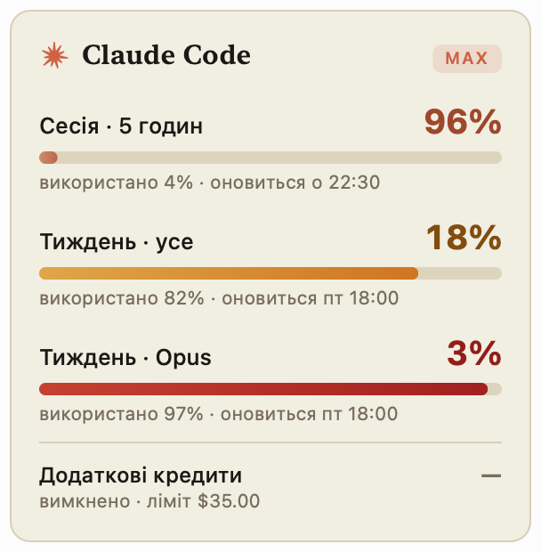

# Claude Usage

Маленький застосунок для меню-бару macOS, який показує, скільки залишилося від
лімітів Claude Code: вікно сесії (5 годин), тижневий ліміт і додаткові кредити.



У меню-барі — значок Claude і відсоток, що залишився від найбільш обмежувального
вікна, напр. `✳ 96%`. Значок і число стають оранжевими на ≤20% і червоними на ≤5%.
У спадному меню — всі вікна зі шкалами й великим відсотком залишку, час скидання,
стан додаткових кредитів і розподіл тижневого ліміту за джерелами
(Claude Code / Chats / Cowork / інше).

## Заборона сну

У меню є перемикач **«Не засинати»** з вибором часу: 15 хв, 30 хв, 1 год, 2 год,
4 год або «поки не вимкну». Коли він активний, у меню-барі біля значка
з'являється крапка, а в самому пункті видно, скільки ще лишилось.

Працює це двома різними механізмами:

* **звичайний сон від бездіяльності** блокується power assertion
  (`PreventUserIdleSystemSleep`) — без паролів; її видно в `pmset -g assertions`
  як `Claude Usage: keep awake`;
* **сон при закритій кришці** macOS не дозволяє заблокувати через assertion —
  єдиний спосіб це системний параметр `pmset -a disablesleep 1`, який потребує
  прав адміністратора. Тому підпункт **«Також із закритою кришкою»** при
  вмиканні показує стандартне вікно macOS із запитом пароля. Якщо скасувати
  запит, заборона сну все одно працюватиме, але лише з відкритою кришкою.

Параметр `disablesleep` переживає завершення процесу, тож застосунок знімає його
при виході (теж із запитом пароля) і, якщо попередній сеанс завершився аварійно,
при наступному старті підхоплює цей стан і дає його вимкнути. Перевірити вручну:
`pmset -g | grep SleepDisabled`.

## Збірка і встановлення

```sh
./build.sh --install     # збирає, кладе в /Applications і запускає
./build.sh               # лише збирає у ./build
```

Потрібні лише Command Line Tools (`swiftc`), без Xcode-проєкту. Мінімальна
версія — macOS 13.

Автозапуск при вході вмикається в самому меню (пункт «Запускати при вході»).

## Як воно працює

* Токен доступу читається з того ж елемента login keychain, яким користується
  сам Claude Code (`Claude Code-credentials`), через `/usr/bin/security` — так,
  як це робить Claude Code. Тому окремого входу й додаткових запитів доступу не
  потрібно.
* Ліміти беруться з `GET https://api.anthropic.com/api/oauth/usage` —
  того ж ендпоінта, який використовує `/usage` у Claude Code.
* Якщо токен прострочений, застосунок оновлює його через
  `https://platform.claude.com/v1/oauth/token` (той самий OAuth client id, що й
  у Claude Code) і зберігає назад у keychain у незмінному форматі, щоб сесія
  Claude Code продовжувала працювати.
* Оновлення — раз на 3 хвилини, при відкритті меню, після виходу зі сну і
  вручну (⌘R у меню).

## Перевірка без інтерфейсу

```sh
./build/ClaudeUsage.app/Contents/MacOS/ClaudeUsage --once
```

Друкує поточні ліміти у термінал — зручно, щоб переконатися, що читання keychain
і запит до API працюють. Для підбору вигляду значка є `--icon шлях.png [розмір]`.
Знімки панелі в `docs/` зроблено офскрін-рендером `UsagePanelView`.

## Видалення

```sh
pkill -x ClaudeUsage
rm -rf /Applications/ClaudeUsage.app
```

Якщо був увімкнений автозапуск, спершу вимкніть його в меню (або в
Системних налаштуваннях → Загальні → Елементи входу).

## Структура

| Файл | Що робить |
| --- | --- |
| `Sources/Credentials.swift` | читання/оновлення OAuth-токена в keychain |
| `Sources/UsageAPI.swift` | запит і розбір відповіді про ліміти |
| `Sources/SleepGuard.swift` | заборона сну: power assertion + `pmset disablesleep`, таймер |
| `Sources/Brand.swift` | палітра Anthropic (book cloth, kraft, manilla), серифний шрифт, кольори станів |
| `Sources/Views.swift` | значок Claude і панель меню (власні view, щоб текст не був приглушений) |
| `Sources/StatusBarController.swift` | іконка в меню-барі та спадне меню |
| `Sources/main.swift` | точка входу, режим `--once` |
| `build.sh` | збірка `.app`, ad-hoc підпис, встановлення |
